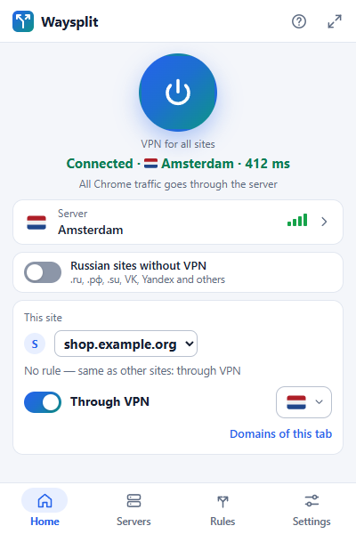

# Waysplit

[Русский](README.md)

I made Waysplit for myself. I wanted the sites I choose to go through a VPN and the rest to go without it. Only through my own VLESS servers, not someone else's. It works only in Chrome and does not touch the rest of the computer. I use it myself and gave it to friends to try.

## What you need

- 64-bit Windows 10 or 11;
- Google Chrome 120 or later;
- your own servers: `vless://…` and `hysteria2://…` links or a subscription URL from your VPN provider.

Waysplit does not provide servers. Administrator rights are not needed.

## How to install

1. Install the companion. It connects to the servers, and Chrome starts it on its own. Download [Waysplit-companion.zip](https://github.com/jacks553/waysplit/releases/latest/download/Waysplit-companion.zip), right-click the archive and choose "Extract All". In the extracted folder, run `Install.cmd` and wait for the line "Done: the companion is installed".
2. Install the extension from the [Chrome Web Store](https://chromewebstore.google.com/detail/waysplit/fdgapnefknckjikbklcanoklhnmcgklg) and pin its icon to the toolbar. The "Getting started" page opens automatically.
3. On that page, paste server links or a subscription URL. Click "Add", then "Turn on VPN".

Checking the archive, updating and uninstalling are described on the page [Install and FAQ](https://jacks553.github.io/waysplit/en/help.html).

### Why Windows warns you

When you run `Install.cmd`, Windows may show the "Windows protected your PC" window. The companion has no paid digital signature, and Windows does not know it. Click "More info", then "Run anyway". The [help page](https://jacks553.github.io/waysplit/en/help.html#windows-warning) explains how to check the archive before running it and how to remove the warning in advance.

## Manual install (fallback)

If the Chrome Web Store does not open for you, you can install the extension by hand from the archive [Waysplit-extension.zip](https://github.com/jacks553/waysplit/releases/latest/download/Waysplit-extension.zip). It is the same version as in the store and needs the same companion. Do not install a manual copy next to the store version in the same Chrome profile. The steps are on the [help page](https://jacks553.github.io/waysplit/en/help.html#manual).

## Switching from the manual version to the store version

Chrome updates the store version automatically. Each copy has its own servers and rules. So first save a backup in the manual version. Then install Waysplit from the store, remove the manual version and restore your data from the backup. You do not need to reinstall the companion. The steps are on the [help page](https://jacks553.github.io/waysplit/en/help.html#switch).

## FAQ

The answers are on the [help page](https://jacks553.github.io/waysplit/en/help.html#faq): where to get servers, why a separate program is needed, what to do if an antivirus deleted the companion or the VPN does not turn on.

## More

- [Install, update, uninstall and FAQ](https://jacks553.github.io/waysplit/en/help.html)
- [How to use](https://jacks553.github.io/waysplit/en/usage.html): servers, subscriptions, site rules, settings
- [For developers](https://jacks553.github.io/waysplit/en/dev.html): how it works, build, tests, release
- [Privacy policy](https://jacks553.github.io/waysplit/privacy.html#en)
- [Report a problem](https://github.com/jacks553/waysplit/issues)
- [What's new](CHANGELOG.md). The changelog is in Russian, with a short English summary for each version since 1.2.0.

License: [Apache 2.0](LICENSE), Copyright 2026 The Waysplit Authors. The [sing-box](https://github.com/SagerNet/sing-box) and [Xray-core](https://github.com/XTLS/Xray-core) cores connect to the servers and have their own licenses: [credits and licenses](https://jacks553.github.io/waysplit/en/dev.html#licenses).
