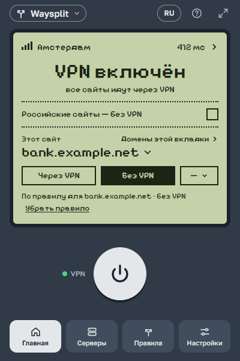

# Waysplit

[English](README.en.md)

Сделал Waysplit для себя. Хотел, чтобы нужные сайты шли через VPN, а остальные напрямую. Только через свои серверы VLESS, а не через чужие. Работает только в Chrome, остальной компьютер VPN не трогает. Пользуюсь сам и дал попробовать друзьям.

У окна два вида: новый, как на картинке, и классический. Вид и тема меняются в меню, которое открывается нажатием на название Waysplit в шапке окна.

## Что нужно

- 64-битная Windows 10 или 11;
- Google Chrome 120 или новее;
- свои серверы: ссылки `vless://…` и `hysteria2://…` или адрес подписки от VPN-провайдера.

Серверов Waysplit не даёт. Права администратора не нужны.

## Как установить

1. Поставьте компаньон. Он подключается к серверам, а запускает его сам Chrome. Скачайте [Waysplit-companion.zip](https://github.com/jacks553/waysplit/releases/latest/download/Waysplit-companion.zip), нажмите на архив правой кнопкой и выберите "Извлечь всё". В распакованной папке запустите `Установить.cmd` и дождитесь строки "Готово: компаньон установлен".
2. Установите расширение из [Chrome Web Store](https://chromewebstore.google.com/detail/waysplit/fdgapnefknckjikbklcanoklhnmcgklg) и закрепите его значок на панели. Сама откроется страница "Начало работы".
3. Вставьте на этой странице ссылки серверов или адрес подписки. Нажмите "Добавить", потом "Включить VPN".

Проверка архива, обновление и удаление описаны на странице [Установка и частые вопросы](https://jacks553.github.io/waysplit/ru/help.html).

### Почему Windows предупреждает

При запуске `Установить.cmd` Windows может показать окно "Система Windows защитила ваш компьютер". У компаньона нет платной цифровой подписи, и Windows его не знает. Нажмите "Подробнее", потом "Выполнить в любом случае". Как сверить архив перед запуском и как убрать предупреждение заранее, написано [на странице помощи](https://jacks553.github.io/waysplit/ru/help.html#windows-warning).

## Ручная установка (запасной вариант)

Если Chrome Web Store у вас не открывается, расширение можно поставить вручную из архива [Waysplit-extension.zip](https://github.com/jacks553/waysplit/releases/latest/download/Waysplit-extension.zip). Версия в нём та же, что в магазине, и компаньон нужен тот же. Не ставьте ручную копию рядом с версией из магазина в одном профиле Chrome. Шаги описаны [на странице помощи](https://jacks553.github.io/waysplit/ru/help.html#manual).

## Переход с ручной версии на версию из магазина

Версию из магазина Chrome обновляет сам. Серверы и правила у каждой копии свои. Поэтому сначала сохраните резервную копию в ручной версии. Затем установите Waysplit из магазина, удалите ручную версию и восстановите данные из копии. Компаньон переустанавливать не нужно. Порядок по шагам есть [на странице помощи](https://jacks553.github.io/waysplit/ru/help.html#switch).

## Частые вопросы

Ответы собраны [на странице помощи](https://jacks553.github.io/waysplit/ru/help.html#faq): где взять серверы, зачем нужна отдельная программа, что делать, если антивирус удалил компаньон или VPN не включается.

## Подробнее

- [Установка, обновление, удаление и частые вопросы](https://jacks553.github.io/waysplit/ru/help.html)
- [Как пользоваться](https://jacks553.github.io/waysplit/ru/usage.html): серверы, подписки, правила для сайтов, настройки
- [Для разработчиков](https://jacks553.github.io/waysplit/ru/dev.html): как всё устроено, сборка, тесты, выпуск
- [Политика конфиденциальности](https://jacks553.github.io/waysplit/privacy.html)
- [Сообщить об ошибке](https://github.com/jacks553/waysplit/issues)
- [Что нового в версиях](CHANGELOG.md)

Лицензия [Apache 2.0](LICENSE), Copyright 2026 The Waysplit Authors. К серверам подключаются ядра [sing-box](https://github.com/SagerNet/sing-box) и [Xray-core](https://github.com/XTLS/Xray-core), у них свои лицензии: [благодарности и лицензии](https://jacks553.github.io/waysplit/ru/dev.html#licenses).
